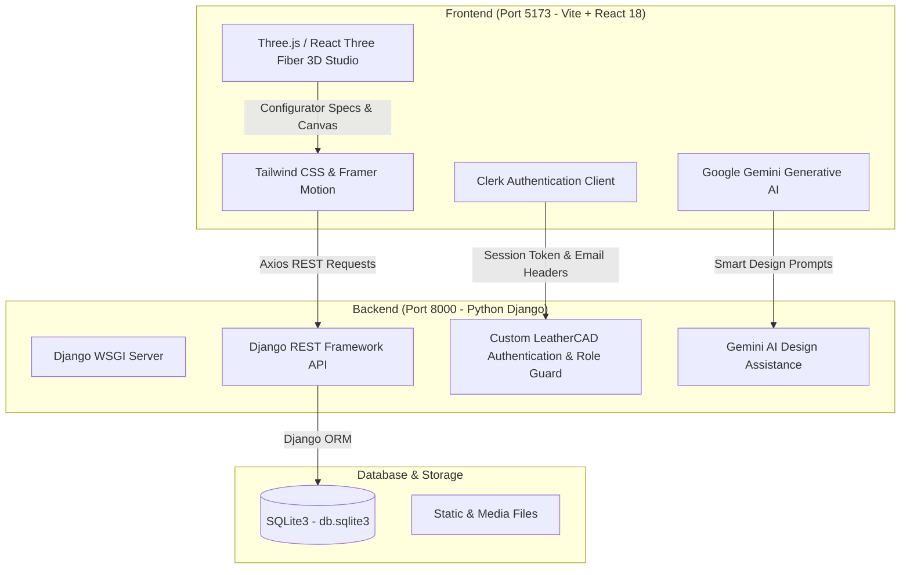

# LeatherCAD Tech Stack & System Architecture

A comprehensive overview of the technology stack, system architecture, and directory structure powering the **LeatherCAD** platform.

---

## 1. High-Level Architecture

LeatherCAD is a decoupled full-stack platform featuring a **Python Django REST Framework** backend, an interactive **React + Three.js 3D** WebGL frontend, and a synchronized multi-role access system (Customer, Designer / Seller, Admin).



---

## 2. Backend Stack (Python Django)

| Component | Technology | Description |
| :--- | :--- | :--- |
| **Language** | Python 3.12+ | Core programming language |
| **Framework** | Django 5.x / 6.x | High-level Python web framework |
| **REST API** | Django REST Framework (DRF) | RESTful API endpoints, viewsets, and JSON serializers |
| **Database** | SQLite (`db.sqlite3`) | Relational database managed through Django ORM migrations |
| **Authentication** | Custom DRF Middleware | Dual-support: Clerk session token decoding + custom JWT tokens with fallback dev headers |
| **CORS** | `django-cors-headers` | Cross-Origin Resource Sharing handling requests from `localhost:5173` |
| **Environment** | Python Virtualenv (`.venv/`) | Isolated Python package dependencies |

### Django Core Structure
- **Project Folder**: `leathercad_backend/`
  - `settings.py`: Application config, database engine, CORS rules, and installed apps.
  - `urls.py`: Root routing delegating `/api/` traffic to the API app.
  - `wsgi.py`: WSGI entry point.
- **Application Folder**: `api/`
  - `models.py`: Database tables (`User`, `Product`, `Order`, `Design`, `Project`, `Material`).
  - `views.py`: API controllers for products, live orders, revenue statistics, AI chat, and materials.
  - `authentication.py`: Role enforcement, admin email whitelist verification, and user permission helpers.
  - `management/commands/seed_data.py`: Pre-populates sample catalog products, materials, orders, and design projects.

---

## 3. Frontend Stack (React + Three.js)

| Component | Technology | Description |
| :--- | :--- | :--- |
| **Runtime & Build** | Node.js + Vite | Ultra-fast dev server with Hot Module Replacement (HMR) and optimized Rollup bundling |
| **UI Framework** | React 18 | Component-driven architecture using functional components and hooks |
| **3D Graphics** | Three.js | WebGL-based rendering for 3D leather products |
| **React 3D Bridge** | `@react-three/fiber` | Declarative Three.js scene graph in React |
| **3D Helpers** | `@react-three/drei` | Camera controls, lighting, orbit helpers, and texture loaders |
| **Styling** | Tailwind CSS | Utility-first responsive dark-themed styling |
| **Animations** | Framer Motion + GSAP | Smooth entrance transitions, modal animations, and micro-interactions |
| **Icons** | Lucide React | Modern vector icon set |
| **Data Visuals** | Recharts | Live admin revenue graphs and order metrics |
| **State & HTTP** | Axios + Zustand | HTTP requests with interceptors and lightweight client-side state |
| **Notifications** | Sonner | Clean interactive toast notifications |

---

## 4. Authentication & Role-Based Access Control (RBAC)

The platform supports 3 primary user personas:

1. **Customer**:
   - Capabilities: Browse catalog, view detailed specs, add items to cart, checkout with INR (`₹`) pricing, view order history.
   - Restriction: 3D customizer tools and `/customizer` route are strictly hidden.
2. **Designer / Seller**:
   - Capabilities: Access the 3D Configurator studio, apply custom materials/colors, set custom selling prices, and publish creations.
   - Access: Unlocks the **3D Customize** button and studio route.
3. **Admin**:
   - Capabilities: Full access to the Admin Workspace (`/admin`), viewing real-time SQLite revenue statistics, pending design approvals, user management, and order tracking.
   - Authorized Admin Whitelist: `kc3737381@gmail.com`, `siddhantpatel09090@gmail.com`.

---

## 5. Artificial Intelligence (AI)

- **Engine**: **Google Gemini Generative AI** (`@google/generative-ai`)
- **Use Case**:
  - **Smart Designer**: Suggests leather materials, color palettes, hardware finishes, and styles based on natural language prompts.
  - **Embedded Assistant**: Interactive floating AI assistant widget in the 3D Studio to assist designers.

---

## 6. Development Scripts & Running the Platform

In `package.json`, unified commands run both the Django API and Vite frontend simultaneously:

```bash
# Start both Python Django API (Port 8000) and Vite React frontend (Port 5173)
npm start

# Run only the Django API server
npm run server

# Run only the Vite development server
npm run dev

# Run Django database migrations
npm run server:migrate

# Seed SQLite database with sample products and orders
npm run server:seed

# Build frontend for production
npm run build
```

---

## 7. Directory Tree Summary

```text
d:/python_jango/
├── .venv/                   # Python virtual environment (Django, DRF, PyJWT)
├── api/                     # Django REST application (models, views, auth, serializers)
│   ├── models.py
│   ├── views.py
│   ├── authentication.py
│   └── urls.py
├── leathercad_backend/      # Django project settings & WSGI configuration
│   ├── settings.py
│   └── urls.py
├── src/                     # React 18 frontend source code
│   ├── components/          # 3D canvas, UI controls, navigation, cart, marketing
│   ├── pages/               # Catalog, Product Detail, 3D Customizer, Admin, Orders
│   ├── hooks/               # useRole (RBAC), custom hooks
│   └── utils/               # Axios API client, currency formatters
├── public/                  # 3D models (.glb, .gltf), textures, and static assets
├── db.sqlite3               # Active centralized SQLite database
├── manage.py                # Django CLI entry point
├── package.json             # Node dependencies and concurrent runner scripts
├── vite.config.js           # Vite configuration
└── tech-stack.md            # Tech stack documentation
```
